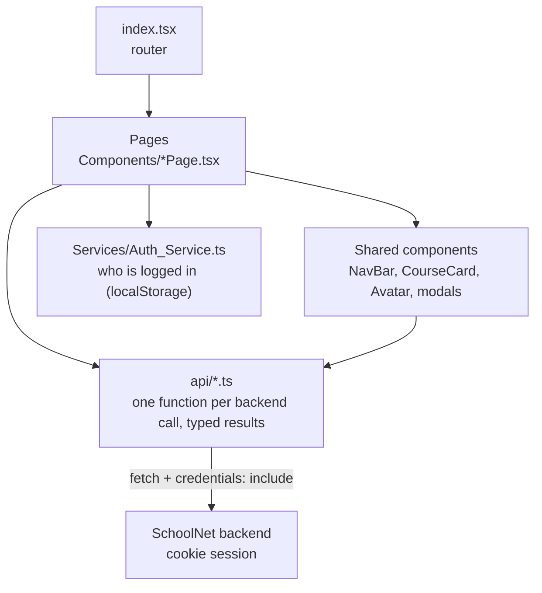
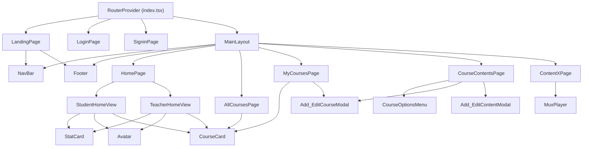
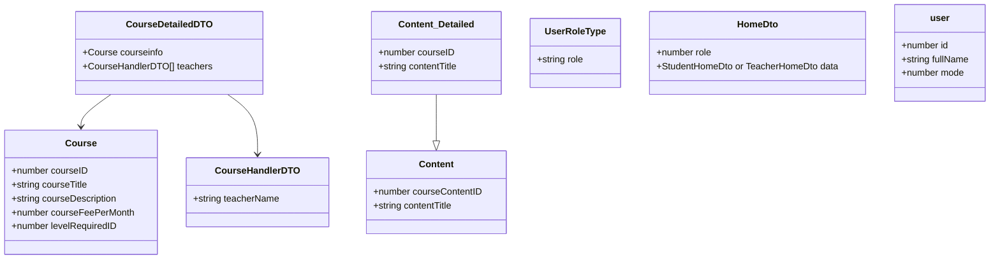
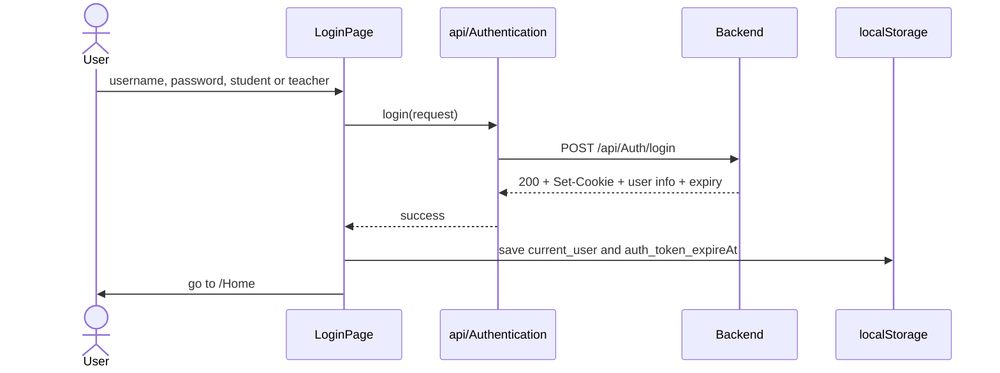
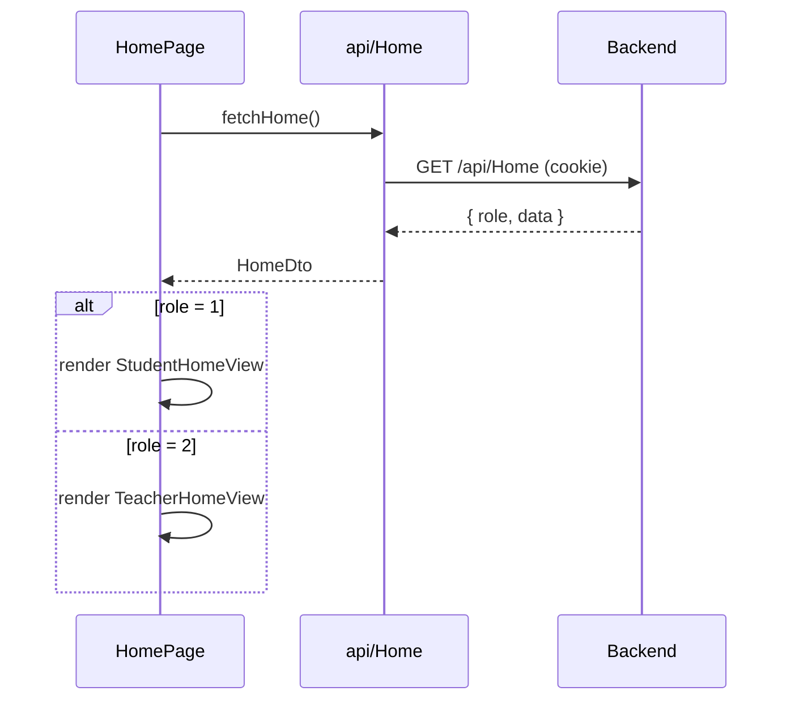
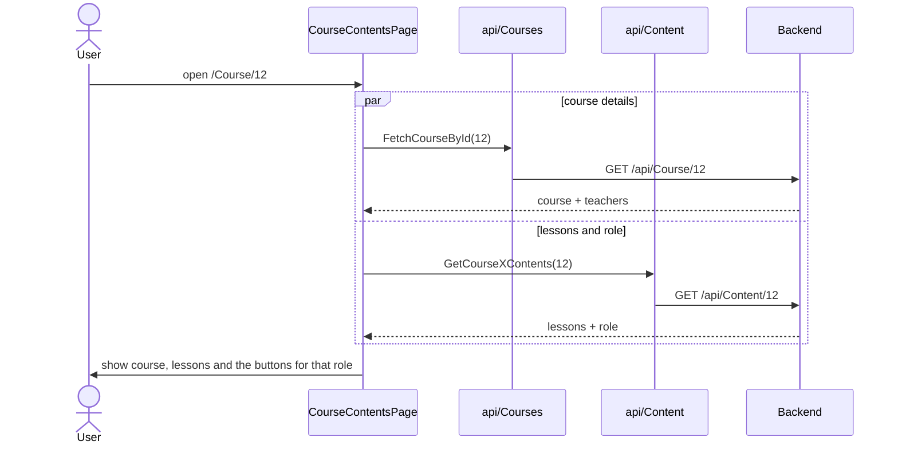
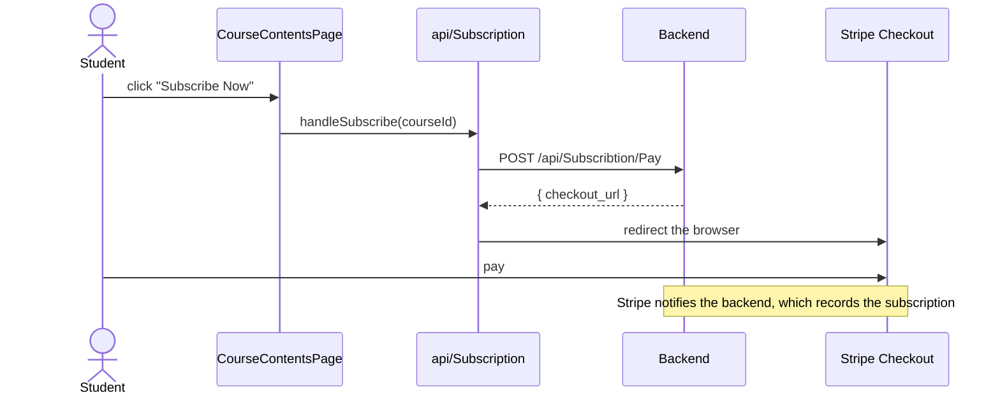
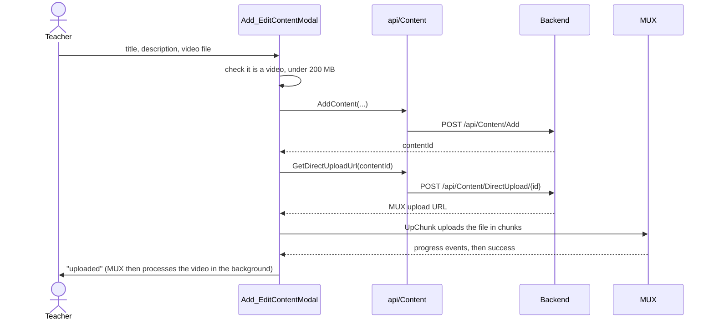
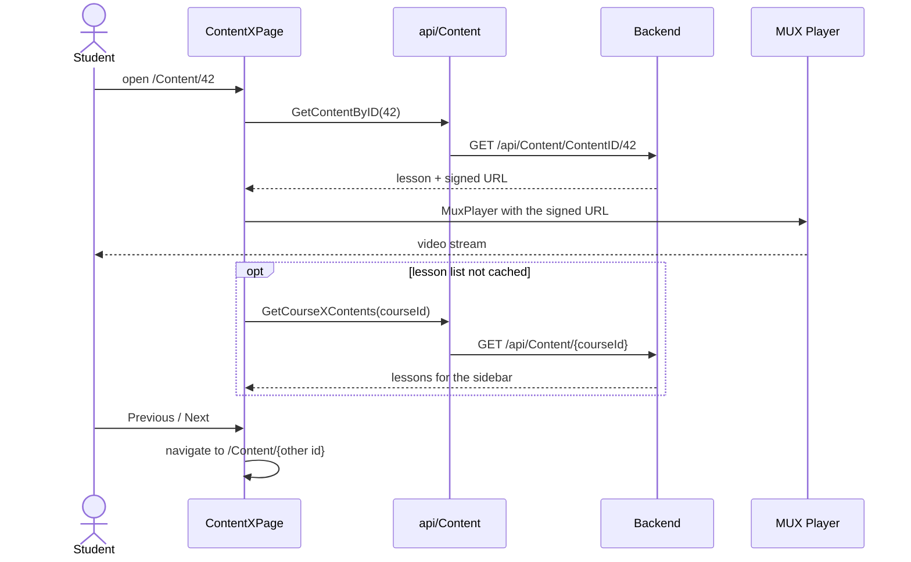

# SchoolNet — Frontend

The web app of SchoolNet, an e-learning platform where teachers publish video courses and students pay to watch them.

Built with **React 19**, **TypeScript**, **React Router 7** and **CSS Modules** (no UI library, all styles are hand-written). Videos play through **MUX Player**, uploads go through **UpChunk**.

> **Project status:** SchoolNet is a work in progress. The main flows below work end to end, but a lot of the project is still not done. Treat it as a learning project and a base to build on, not as production software.

The API this app talks to lives in its own repository: **SchoolNet backend**.

---

## Contents

- [Getting started](#getting-started)
- [How the app is organised](#how-the-app-is-organised)
- [Pages and routes](#pages-and-routes)
- [Class diagrams](#class-diagrams)
- [Sequence diagrams](#sequence-diagrams)
- [Authentication](#authentication)
- [Project structure](#project-structure)

---

## Getting started

**You need:** [Node.js](https://nodejs.org/) 18 or later, and the backend running (default `http://localhost:5000`).

```bash
npm install
npm start
```

The app opens on **http://localhost:3000**. That origin is the one the backend allows through CORS, so keep this port.

If your backend runs somewhere else, change the one constant that every request uses:

```ts
// src/api/ApiConf.ts
export const ApiURL = "http://localhost:5000/api/";
```

Other scripts: `npm run build` (production bundle) and `npm test`.

---

## How the app is organised

Three simple layers. Components never call `fetch` themselves; they go through the `api/` modules.



**Data flow in one sentence:** a page asks an `api/` function for data, the function calls the backend with the session cookie and returns `{ success: true, data }` or `{ success: false, message }`, and the page decides what to render.

---

## Pages and routes

Routes are declared in `src/index.tsx`. Pages that share the navbar and footer are wrapped in `MainLayout`.

| Path | Page | What it shows |
|---|---|---|
| `/` | `LandingPage` | Public welcome page |
| `/Login` | `LoginPage` | Login, as student or teacher |
| `/Signin` | `SigninPage` | Multi-step registration |
| `/Home` | `HomePage` | Dashboard: stats and courses, different for student and teacher |
| `/Courses` | `AllCoursesPage` | Every course as a grid of cards |
| `/MyCourses` | `MyCoursesPage` | Courses the user teaches or is subscribed to; teachers can add a course |
| `/Course/:CourseID` | `CourseContentsPage` | Course details and lesson list; subscribe button; teacher edit menu |
| `/Content/:ContentID` | `ContentXPage` | Video player for one lesson, with previous / next |
| anything else | `HomePage` | Fallback |

What the course page shows depends on the role the backend returns for that course:

| Role | Subscribe button | Edit button |
|---|---|---|
| `guest` | – | – |
| `new_student` | shown | – |
| `subscribed_student` | – | – |
| `teacher` | – | shown |

---

## Class diagrams

The app is made of function components, so these diagrams show the **component tree** and the **data types** exchanged with the backend rather than classes.

### Component tree



### Data types

The main shapes (simplified) that travel between the `api/` modules, the pages and the backend.



`UserRoleType.role` is one of `guest`, `new_student`, `subscribed_student` or `teacher`.

### The `api/` modules

| File | Functions |
|---|---|
| `Authentication.ts` | login and sign-up calls for both roles |
| `Courses.ts` | `FetchAllCourses`, `FetchCourseById`, `FetchCoursesOfUserX`, `AddCourse` |
| `Content.ts` | `GetCourseXContents`, `GetContentByID`, `AddContent`, `GetDirectUploadUrl` |
| `Subscription.ts` | `handleSubscribe`, `checkUserHasAccess` |
| `Home.ts` | `fetchHome` and the dashboard types |

---

## Sequence diagrams

### 1. Log in

The real session is an `HttpOnly` cookie set by the backend. The app only keeps a small copy of the user in `localStorage` to show the name and pick the right UI.



### 2. Open the dashboard

The home page is one route for two audiences. The backend decides which one the caller is, and the page renders the matching view.



### 3. Browse a course

The course page loads two things in parallel: the course details, and the lesson list together with the caller's role for this course. The role drives which buttons appear.



### 4. Subscribe to a course

The app never handles card details. It sends the student to Stripe's hosted payment page and the backend finds out about the payment from Stripe directly.



### 5. Add a lesson with a video (teacher)

Three steps from the modal. The video itself goes straight from the browser to MUX in chunks, so large files never pass through the backend.



### 6. Watch a lesson

The backend returns a **signed, expiring** playback URL, and the player streams from MUX with it. The lesson list in the sidebar comes from `sessionStorage` when the user arrived from the course page, otherwise it is fetched.



---

## Authentication

| Where | What | Why |
|---|---|---|
| `HttpOnly` cookie (set by the backend) | the session | the real proof of identity, sent automatically with every request |
| `localStorage` → `current_user` | id, full name, role | only to display the name and choose the UI |
| `localStorage` → `auth_token_expireAt` | expiry date | lets the app know when the session is probably over |

Every `fetch` uses `credentials: "include"` so the cookie is sent across origins. Helpers live in `src/Services/Auth_Service.ts`:

```ts
getCurrentUser()        // the saved user, or null
CurrentTokenIsValide()  // false once the expiry date has passed
```

The UI hiding a button is only a convenience. The backend checks the cookie on every protected call and is the one that decides what is allowed.

---

## Project structure

```
schoolnet-FE/
├── public/
└── src/
    ├── index.tsx                    router, app entry point
    ├── index.css                    global styles and CSS variables
    ├── api/                         backend calls + their types
    │   ├── ApiConf.ts               base URL
    │   ├── Authentication.ts
    │   ├── Courses.ts
    │   ├── Content.ts
    │   ├── Home.ts
    │   └── Subscription.ts
    ├── Services/
    │   └── Auth_Service.ts          reads the saved user from localStorage
    └── Components/
        ├── MainLayout.tsx           navbar + footer wrapper
        ├── *Page.tsx                one file per route
        ├── StudentHomeView.tsx / TeacherHomeView.tsx
        ├── CourseCard.tsx, StatCard.tsx, Avatar.tsx, NavBar.tsx, Footer.tsx
        ├── Add_EditCourseModal.tsx, Add_EditContentModal.tsx
        ├── CourseOptionsMenu.tsx
        └── *.module.css             styles scoped to the component next to them
```

### Conventions

- One component per file, with its CSS Module beside it (`Thing.tsx` and `ThingStyle.module.css`).
- Backend calls only in `src/api/`. Components import those functions and never call `fetch` directly.
